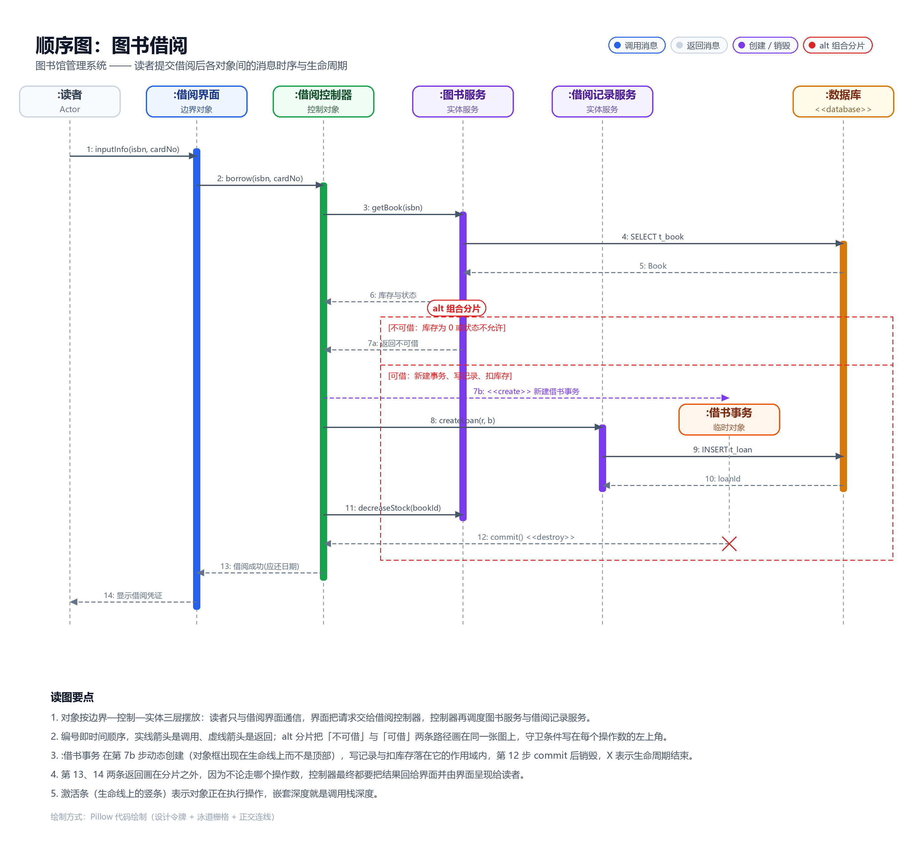
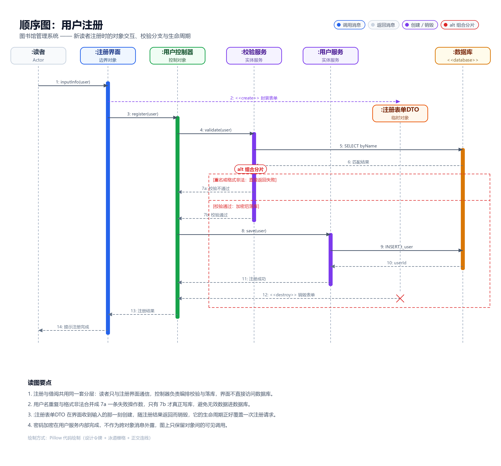

# 图书馆管理系统（LMS）—— 关键功能顺序图设计

题干要求从「图书借阅」「用户注册」等功能中至少选一个关键功能设计顺序图，这里两个都做了，各出一张图。

## 一、参与对象是怎么定出来的

顺序图的对象不是凭空画的，而是把用例的分析类模型按「边界—控制—实体」三层摊开：

| 层 | 图书借阅 | 用户注册 | 依据 |
|---|---|---|---|
| 边界对象 | :借阅界面 | :注册界面 | 读者唯一的交互入口，对应系统功能里的「借阅图书」「用户注册」 |
| 控制对象 | :借阅控制器 | :用户控制器 | 一个用例一个控制器，负责编排，不碰数据库 |
| 实体/服务 | :图书服务、:借阅记录服务 | :校验服务、:用户服务 | 对应题干里的图书资源、借阅记录、用户信息三类数据 |
| 存储 | :数据库 | :数据库 | 带 `<<database>>` 构造型 |
| 临时对象 | :借书事务 | :注册表单DTO | 生命周期只覆盖一次请求，用来满足「对象生命周期」这一评分点 |

读者（:读者）作为外部 Actor 画在最左侧，它不是系统内部对象，所以不画激活条以外的实现细节。

## 二、消息序列说明

### 2.1 图书借阅

| 编号 | 消息 | 方向 | 说明 |
|---|---|---|---|
| 1 | inputInfo(isbn, cardNo) | 读者 → :借阅界面 | 读者录入借书证号与图书 ISBN |
| 2 | borrow(isbn, cardNo) | :借阅界面 → :借阅控制器 | 界面把输入交给控制器 |
| 3 | getBook(isbn) | :借阅控制器 → :图书服务 | 按 ISBN 取图书 |
| 4 | SELECT t_book | :图书服务 → :数据库 | 持久化查询 |
| 5 | Book | :数据库 → :图书服务 | 返回图书记录 |
| 6 | 库存与状态 | :图书服务 → :借阅控制器 | 返回可借判断所需的库存与状态 |
| 7a | 返回不可借 | :图书服务 → :借阅控制器 | alt 第一操作数：库存为 0 或状态不允许 |
| 7b | <<create>> 新建借书事务 | :借阅控制器 → :借书事务 | alt 第二操作数：动态创建临时对象 |
| 8 | createLoan(r, b) | :借阅控制器 → :借阅记录服务 | 生成借阅记录 |
| 9 | INSERT t_loan | :借阅记录服务 → :数据库 | 落库 |
| 10 | loanId | :数据库 → :借阅记录服务 | 返回主键 |
| 11 | decreaseStock(bookId) | :借阅控制器 → :图书服务 | 扣减可借库存 |
| 12 | commit() <<destroy>> | :借书事务 → :借阅控制器 | 提交并销毁，生命线上以 X 结束 |
| 13 | 借阅成功(应还日期) | :借阅控制器 → :借阅界面 | 回传结果与应还日期 |
| 14 | 显示借阅凭证 | :借阅界面 → :读者 | 呈现给读者 |

### 2.2 用户注册

| 编号 | 消息 | 方向 | 说明 |
|---|---|---|---|
| 1 | inputInfo(user) | 读者 → :注册界面 | 录入用户名、密码、邮箱 |
| 2 | <<create>> 封装表单 | :注册界面 → :注册表单DTO | 收到输入即创建临时对象 |
| 3 | register(user) | :注册界面 → :用户控制器 | 提交注册 |
| 4 | validate(user) | :用户控制器 → :校验服务 | 请求校验 |
| 5 | SELECT byName | :校验服务 → :数据库 | 查同名用户 |
| 6 | 匹配结果 | :数据库 → :校验服务 | 返回查询结果 |
| 7a | 校验不通过 | :校验服务 → :用户控制器 | alt 第一操作数：重名或格式非法 |
| 7b | 校验通过 | :校验服务 → :用户控制器 | alt 第二操作数 |
| 8 | save(user) | :用户控制器 → :用户服务 | 只有 7b 才真正落库 |
| 9 | INSERT t_user | :用户服务 → :数据库 | 写入用户 |
| 10 | userId | :数据库 → :用户服务 | 返回主键 |
| 11 | 注册成功 | :用户服务 → :用户控制器 | 回传 |
| 12 | <<destroy>> 销毁表单 | :注册表单DTO → :用户控制器 | 临时对象生命周期结束 |
| 13 | 注册结果 | :用户控制器 → :注册界面 | 回传界面 |
| 14 | 提示注册完成 | :注册界面 → :读者 | 呈现给读者 |

## 三、对着评分标准自查

| 评分点 | 占比 | 图上的落点 |
|---|---|---|
| 对象的正确性 | 10% | 五个对象加一个外部 Actor，全部由题干的 8 个功能反推，见第一节对照表 |
| 交互的正确性 | 25% | 界面不直连数据库，一律经控制器调度；查询、写库、扣库存分别落到各自的服务上 |
| 消息的顺序 | 35% | 编号 1→14 即时间顺序，返回消息用虚线，调用用实线，可借/不可借用 alt 分片显式分叉 |
| 对象的生命周期 | 20% | :借书事务 与 :注册表单DTO 都不在顶部出现，而是在被创建的那一行以对象框形式出现，销毁处画 X |
| 顺序图的清晰度 | 10% | 顶部统一摆放对象、生命线等距、每条消息带编号与参数、分片守卫条件写在左上角 |

## 四、两点设计取舍

1. 密码加密没有单独画成一条消息。它是 :用户服务 内部行为，顺序图只表达对象间的可见交互，画出来反而会让读者误以为存在一个「加密服务」对象。
2. 第 13、14 条返回画在 alt 分片之外。因为不论走哪个操作数，控制器最终都要把结果回给界面，把它们塞进分片会重复画两遍。
