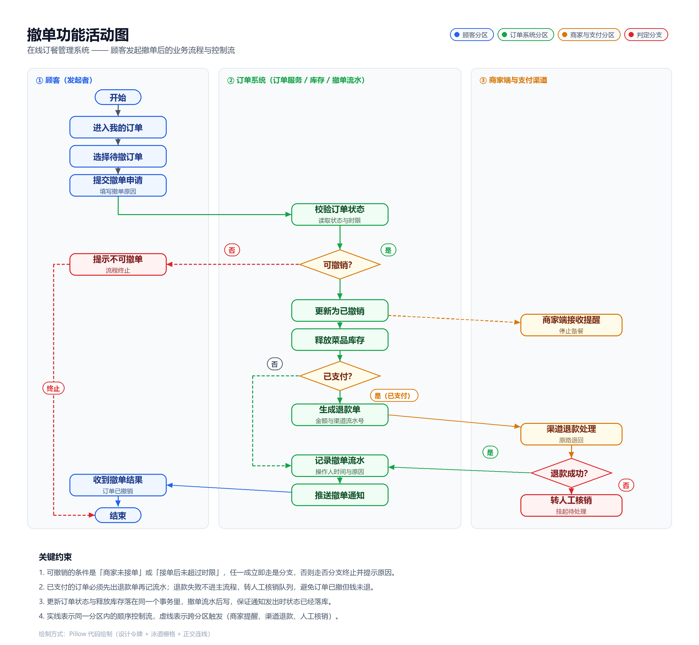
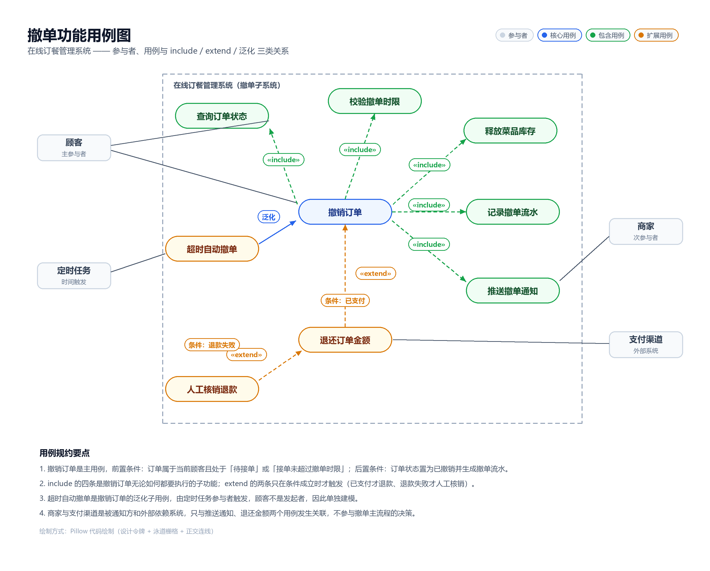

# 在线订餐管理系统 —— 「撤单」功能业务流程分析与用例建模

## 一、业务流程分析

### 1.1 场景界定

顾客在平台上完成下单后，因为临时改变主意、菜品重复下单、商家出餐慢等原因，需要在**商家实际开始履约之前**取消这笔订单，这个动作在业务上称为「撤单」。撤单不是简单地把订单删掉，它同时牵动三件事：订单状态要改、已经占用的菜品库存要还回去、已经收进来的钱要退回去。所以撤单必须做成一条有判定、有分支、有补偿的业务流程，而不是一个孤立的按钮。

### 1.2 业务规则（判定的依据）

| 编号 | 规则 | 说明 |
|---|---|---|
| BR-1 | 只有「待接单」状态的订单可以直接撤 | 商家未接单，钱和库存都还在可回滚窗口内 |
| BR-2 | 「已接单」状态在撤单时限内（本系统取 2 分钟）允许撤 | 超过时限进入备餐，撤单会造成损耗，需商家确认 |
| BR-3 | 「配送中」「已完成」「已取消」状态一律不可撤 | 直接给顾客返回不可撤原因，流程终止 |
| BR-4 | 已支付订单撤单必须原路退款 | 未支付订单只关单不退款 |
| BR-5 | 退款失败不能让撤单半途而废 | 订单已撤但款未退时，转人工核销队列，禁止直接记成功 |
| BR-6 | 库存释放与订单状态变更在同一事务内 | 避免出现「订单已撤但菜品仍显示售罄」 |

### 1.3 主流程步骤（与活动图节点一一对应）

1. 顾客进入「我的订单」列表；
2. 选择一笔处于可撤状态的订单，点击「撤单」；
3. 填写撤单原因并提交申请；
4. 订单服务读取订单当前状态与下单时间，按 BR-1～BR-3 校验是否可撤销；
5. 判定不通过：返回不可撤原因，界面提示，流程终止；
6. 判定通过：把订单状态更新为「已撤销」，同一事务内释放菜品库存；
7. 商家端同步收到撤单提醒，停止备餐；
8. 判定该订单是否已支付；
9. 未支付：跳过退款，直接记录撤单流水；
10. 已支付：生成退款单（带金额与渠道流水号），调用支付渠道原路退款；
11. 渠道回执成功：记录撤单流水；回执失败：转人工核销队列挂起，等运营处理后再补录；
12. 统一向顾客、商家推送撤单结果通知，流程结束。

### 1.4 活动图

图元约定：三个竖向分区表示「谁在做」（顾客 / 订单系统 / 商家与支付渠道）；圆角矩形是活动节点，菱形是判定节点且每条分支都带「是 / 否」标签；实线是同一分区内的顺序控制流，虚线是跨分区触发。开始与结束用胶囊节点表示活动初态与终态。

---

## 二、系统用例识别与描述

### 2.1 参与者

| 参与者 | 类型 | 与撤单的关系 |
|---|---|---|
| 顾客 | 主参与者 | 撤单用例的发起者，唯一的人工触发入口 |
| 定时任务 | 辅助参与者（时间触发） | 触发「超时自动撤单」，顾客不参与 |
| 商家 | 次参与者 | 接收撤单提醒，人工核销时确认损耗 |
| 支付渠道 | 外部系统 | 执行退款并回执，决定退款分支走向 |

### 2.2 用例清单

| 编号 | 用例名称 | 参与者 | 关系 | 说明 |
|---|---|---|---|---|
| UC-01 | 撤销订单 | 顾客、定时任务 | 主用例 | 完成撤单的全部业务动作 |
| UC-02 | 查询订单状态 | 顾客 | UC-01 «include» | 撤单前必须取到当前状态与下单时间 |
| UC-03 | 校验撤单时限 | 系统 | UC-01 «include» | 按 BR-1～BR-3 判定可撤与否 |
| UC-04 | 释放菜品库存 | 系统 | UC-01 «include» | 把下单时占用的库存归还 |
| UC-05 | 记录撤单流水 | 系统 | UC-01 «include» | 落操作人、时间、原因、金额 |
| UC-06 | 推送撤单通知 | 商家 | UC-01 «include» | 顾客与商家两侧通知 |
| UC-07 | 退还订单金额 | 支付渠道 | UC-01 «extend»，条件「已支付」 | 只有已支付分支才触发 |
| UC-08 | 人工核销退款 | 商家、运营 | UC-07 «extend»，条件「退款失败」 | 退款回执失败后的补偿路径 |
| UC-09 | 超时自动撤单 | 定时任务 | UC-01 的泛化子用例 | 商家超时未接单，系统代为撤单 |

### 2.3 用例图

关系画法：`«include»` 用虚线箭头指向被包含用例，表示基用例执行时一定会走到；`«extend»` 用虚线箭头从扩展用例指向基用例并标注触发条件，表示只在条件成立时才执行；泛化用实线箭头从子用例指向父用例，表示子用例继承父用例的结构与语义。

### 2.4 UC-01 撤销订单（用例规约）

| 项 | 内容 |
|---|---|
| 用例标识 | UC-01 撤销订单 |
| 参与者 | 顾客（主）、定时任务（触发超时分支） |
| 前置条件 | 订单归属于当前顾客；订单状态为「待接单」，或为「已接单」且未超过撤单时限 |
| 后置条件（成功） | 订单状态置为「已撤销」；菜品库存已归还；生成一条撤单流水；顾客与商家收到通知 |
| 后置条件（失败） | 订单状态不变；界面给出不可撤原因；不产生流水记录 |
| 基本流 | 1 顾客打开我的订单 → 2 选择订单并点击撤单 → 3 填写撤单原因提交 → 4 系统读取订单状态与下单时间（UC-02）→ 5 校验撤单时限（UC-03）→ 6 更新订单为已撤销并释放库存（UC-04）→ 7 记录撤单流水（UC-05）→ 8 推送撤单通知（UC-06） |
| 备选流 A1 | 第 5 步判定不可撤：返回原因（BR-3），流程终止，订单保持原状态 |
| 备选流 A2 | 第 6 步之后判定为已支付：生成退款单并调用支付渠道退款（UC-07），退款成功后再回到第 7 步记流水 |
| 备选流 A3 | 第 7 步退款失败：不记成功流水，订单进入人工核销队列（UC-08），由运营与商家确认损耗后补录 |
| 异常流 E1 | 更新状态与释放库存的同一事务失败：整体回滚，订单状态与库存都保持原值，提示「撤单失败，请重试」 |
| 异常流 E2 | 通知推送失败：不回滚撤单结果，通知进重试队列，保证业务状态优先 |
| 业务规则 | BR-1 ～ BR-6 |
| 非功能约定 | 撤单接口响应 500ms 内；同一订单的撤单请求按订单号加锁，保证幂等，重复提交只生效一次 |

### 2.5 UC-09 超时自动撤单（简要规约）

参与者为定时任务；触发条件是订单在「待接单」状态停留超过商家承诺接单时长（默认 15 分钟）；执行时继承 UC-01 的基本流，但跳过顾客提交申请的第 1～3 步，撤单原因固定写「商家超时未接单，系统自动撤单并全额退款」，退款分支必定执行（此类订单已支付）。

### 2.6 UC-07 退还订单金额（简要规约）

扩展基用例 UC-01，触发条件「订单已支付」。前置条件：撤单已生效且退款单已生成。基本流：向支付渠道发起原路退款 → 等待异步回执 → 回执成功则回写退款单状态。失败走 UC-08 人工核销。金额按订单实付金额（不含优惠券抵扣部分）退回，优惠券按平台规则判断是否返还。
